<h2>Hi, I'm Pakon 👋</h2>

<strong>AI Engineer · Data Engineer</strong>

  I build practical AI and data systems around evaluation, data quality,
  observability, reliable pipelines, and evidence-backed automation.

  
  
  

## Featured AI Engineering projects

Selected for **AI Engineer / Applied AI Engineer** roles in Thailand. Demos clearly distinguish deterministic fixtures from optional real-model inference.

| Project | Engineering evidence | Explore |
| --- | --- | --- |
| **Receipt AI Expense Tracker** | Thai/English document extraction pipeline, financial reconciliation, human review, privacy-aware local storage; hosted demo uses synthetic/mock inference by default. | [Repo](https://github.com/Praciller/receipt-ai-expense-tracker) · [Demo](https://receipt-ai-expense-tracker-eta.vercel.app/) |
| **Customer Support RAG Triage Agent** | Bounded retrieval, typed LangGraph workflow, grounding checks, evaluation, and human-action routing; public demo uses synthetic records and deterministic generation. | [Repo](https://github.com/Praciller/customer-support-rag-triage-agent) · [Demo](https://customer-support-rag-triage-agent.onrender.com/) |
| **EvalOps Lab** | Retrieval evaluation, versioned evidence, regression policies, CI gates, and failure analysis. Public console displays sanitized synthetic evidence, not live model execution. | [Repo](https://github.com/Praciller/evalops-lab) · [Evidence](https://praciller.github.io/evalops-lab/) |
| **VeriClaim AI** | Evidence-driven claim verification, bounded agent workflow, provenance, and reproducible evaluation. Hosted demo is fixture-only. | [Repo](https://github.com/Praciller/vericlaim-ai) · [Demo](https://vericlaim-web.vercel.app/) |
| **OpenDQ Observatory** | Operational data quality, drift monitoring, incidents, lineage, deterministic RCA, and bounded AI explanations. | [Repo](https://github.com/Praciller/opendq-observatory) · [Live](https://opendq-observatory.vercel.app/) |
| **Thai Review Sentiment Intelligence** | Thai NLP model training, reproducible splits, baseline comparison, macro-F1 evaluation, and FastAPI inference. | [Repo](https://github.com/Praciller/thai-review-sentiment-intelligence) · [Demo](https://thai-review-sentiment-intelligence.onrender.com/) |

**Additional data / backend engineering:** [Thai Procurement Intelligence](https://github.com/Praciller/thai-procurement-intelligence) · [Urban Mobility Data Platform](https://github.com/Praciller/urban-mobility-data-platform) · [OpsPulse AI](https://github.com/Praciller/opspulse-ai) · [StockRush Go](https://github.com/Praciller/stockrush-go).

[All public repositories](https://github.com/Praciller?tab=repositories)

## Core stack

  
  
  
  
  
  
  
  
  
  
  
  

## Latest notes

<!-- BLOG-POST-LIST:START -->
- [Demo ผ่านแล้ว ทำไม AI ยังไม่พร้อมใช้จริง?](https://dreamlogsdata.com/writing/prototype-to-production-ai/)
- [AI ตอบผิด แล้วเราจะรู้ได้อย่างไร?](https://dreamlogsdata.com/writing/ai-observability/)
- [งานไหนให้ AI ทำเอง งานไหนต้องให้คนตรวจ?](https://dreamlogsdata.com/writing/human-in-the-loop-ai/)
<!-- BLOG-POST-LIST:END -->

  
<strong>GitHub stats</strong>

   
  

    
    
  

